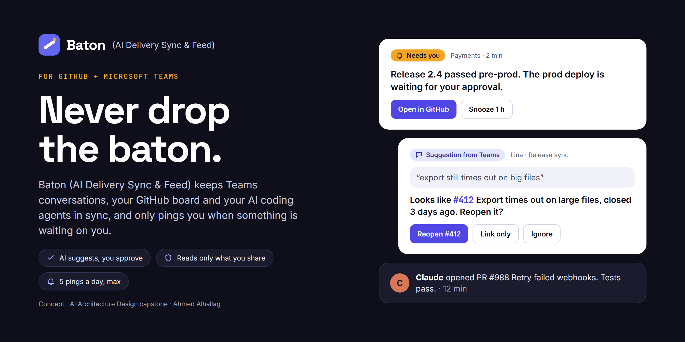
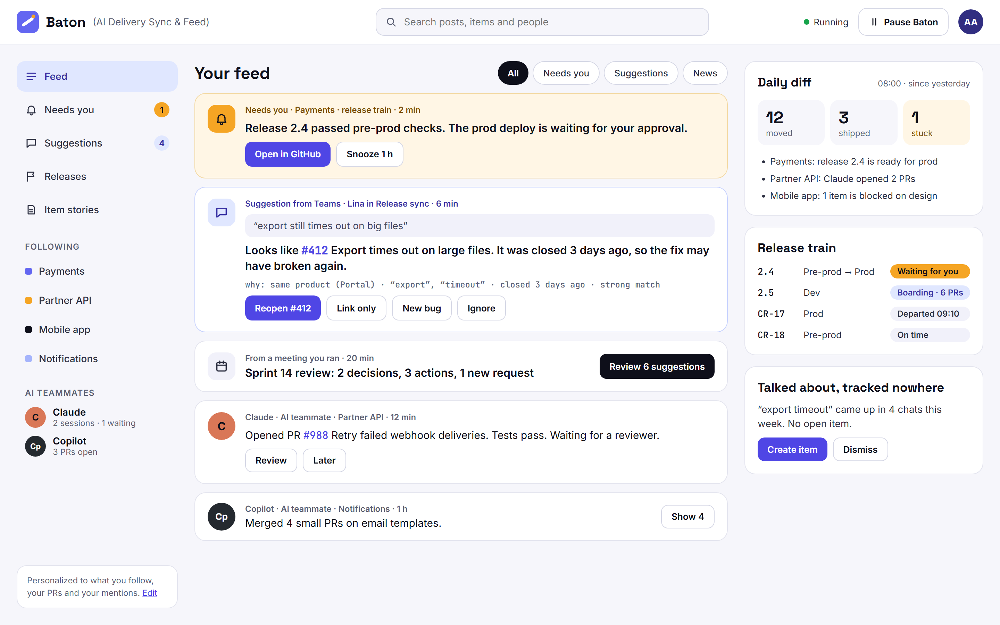
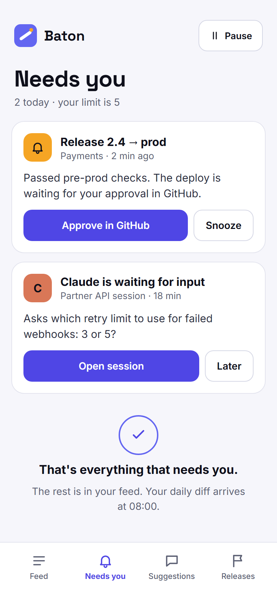
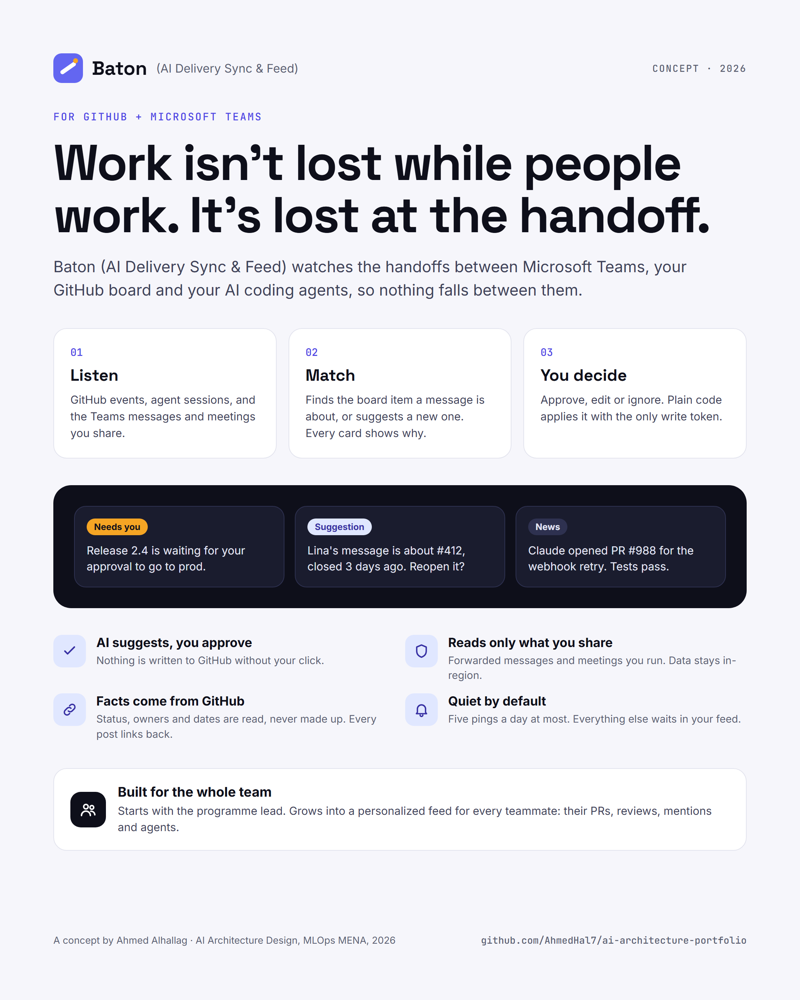

# 🚀 Launch kit — Baton (AI Delivery Sync & Feed)

Product and marketing visuals for Baton (AI Delivery Sync & Feed for GitHub and Microsoft Teams), designed in **Claude Design**. All names and data are fictional; this is a course concept, not a released product.

| Visual | Size | Use it for |
| :--- | :--- | :--- |
| [Hero banner](baton-hero-banner.png) | 1280 × 640 | README header, GitHub social preview, LinkedIn banner |
| [Desktop feed](baton-desktop-feed.png) | 1440 × 900 | The product at a glance: needs you, suggestions, news, daily diff, release train |
| [Mobile: Needs you](baton-mobile-needs-you.png) | 390 × 844 | The calm-ping promise: only what waits on you |
| [Launch poster](baton-launch-poster.png) | 1080 × 1350 | Social post: the problem, how it works, the trust promises |

📰 **Working-backwards press release:** [press-release.md](press-release.md)

---

### The product

<table>
<tr>
<td width="36%"></td>
<td></td>
</tr>
</table>

---

### Brand

| | |
| :--- | :--- |
| **Name** | Baton (AI Delivery Sync & Feed) |
| **Tagline** | Never drop the baton. |
| **Story** | Relay races are lost at the handoff, not on the straight. So is software delivery. |
| **Colours** | Ink `#0E0F1A` · Paper `#F6F6FB` · Baton indigo `#6366F1` / `#4F46E5` · Handoff amber `#F5A524` |
| **Type** | Space Grotesk (headlines) · Inter (text) · JetBrains Mono (IDs and labels) |
| **Logo** | A baton crossing an indigo tile; the amber dot is the handoff |

### Sources

The `src/*.dc.html` files are the Claude Design artboards. They are plain static HTML, so they open in any browser.
