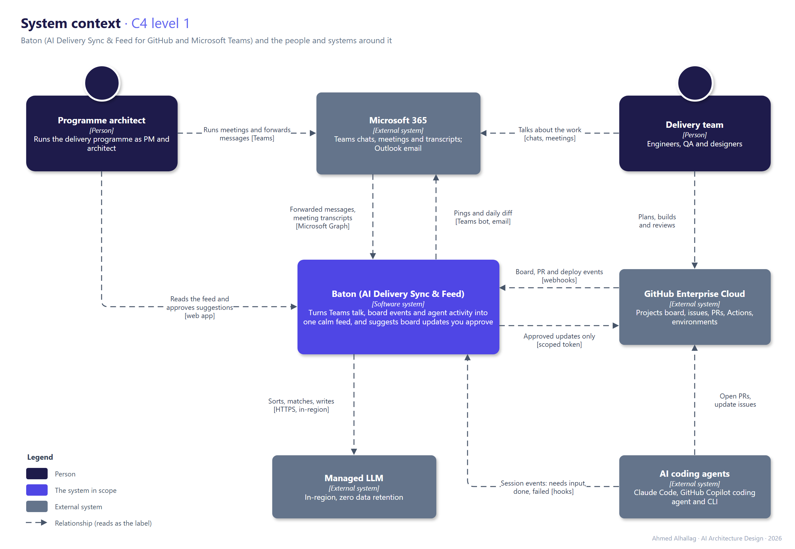
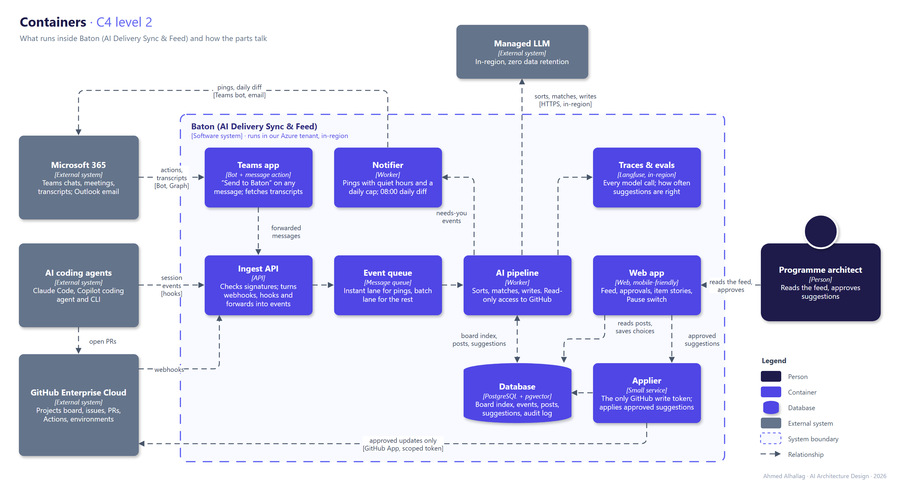

# 🧭 Session 1 — Framing: Baton (AI Delivery Sync & Feed for GitHub and Microsoft Teams)

> **Capstone part 1** (due 14 Nov 2026): the scenario, problem statement, ranked quality attributes, and C4 levels 1 and 2. The goals, principles and decisions are in the [governance pack](governance-pack-wiki.md).

## Scenario

**Bunyan Digital** (fictional) is a software consultancy in Riyadh that builds products for enterprise clients. Its **Atlas** delivery programme runs:

* **5 products** on **one GitHub Projects board**: about 650 items, 15 workstreams, 2 release trains (main and change requests) and 3 environments (dev, pre-prod, prod).
* **9 people**: engineers, QA, designers, plus a programme architect who plays product manager, architect and engineering lead at once.
* **3 AI teammates**: Claude Code, GitHub Copilot coding agent and Copilot CLI. They open PRs, run sessions and wait for input.
* **Microsoft Teams** for everything said: chats, channels and about 12 meetings a week.

## Problem statement

Work is talked about in Teams, tracked on GitHub and increasingly done by AI agents, and the three drift apart. The programme architect is the glue. They read dozens of threads, copy meeting outcomes onto the board by hand, and open GitHub over and over to see what agents did. Work gets lost **at the handoffs**: an action agreed in a meeting never reaches the board, an agent's PR waits two days for review, a release sits in pre-prod waiting for an approval nobody noticed. Meanwhile about 150 notifications a day bury the few that matter.

**Baton (AI Delivery Sync & Feed)** keeps talk, track and agents in sync. It writes one calm feed, pings only when something is waiting on a human, and suggests board updates from Teams that a human approves.

## Stakeholders

| Who | What they care about | Where it's answered |
| :--- | :--- | :--- |
| Programme architect (primary user, v1) | Fewer interruptions, nothing lost, one place to look | Feed, pings, suggestions; G1–G4 |
| Delivery team (users from v2) | A personalized feed; fewer "any update?" questions; not being watched | Roadmap v2; P6 |
| AI teammates' owners | Clear tasks and fast reviews for agent PRs | G3; pings when an agent waits |
| Client stakeholders | Their information stays private and in-region | P5, ADR-0002 |
| IT / Microsoft 365 admin | Least permissions, no tenant-wide reading | ADR-0001 |
| Security and compliance | Write access, audit, retention | ARB checklist, audit log |
| Leadership | Programme health at a glance | Daily diff, release-train view |

## Quality attributes (ranked)

| # | Attribute | Why it ranks here | Target |
| :- | :--- | :--- | :--- |
| 1 | **Trust (accuracy)** | A wrong card or a wrong fact and people stop reading | Right item on top ≥ 85%; 0 writes without approval; 0 invented facts |
| 2 | **Privacy and security** | Client details in chats; a write token to the board | Reads only what's shared; in-region; one scoped write token |
| 3 | **Calm (signal over noise)** | The problem today is noise | ≤ 5 pings a day; ≥ 80% acted on within an hour |
| 4 | **Timeliness** | Approvals and stuck agents can't wait | Pings < 1 min; suggestions < 2 min; meetings < 15 min |
| 5 | **Cost** | It must cost less than the time it saves | Under 5 cents per suggestion (checked in Session 2) |
| 6 | **Availability** | It's an overlay: GitHub and Teams keep working without it | Replays missed events from GitHub after an outage |

## Scope

**In v1:** one board, one programme lead; GitHub events, agent session events, forwarded Teams messages, transcripts of meetings you run; feed, pings, daily diff, suggestion cards.

**Later:** a personalized feed for every teammate (v2); selected Teams channels and hand-offs to coding agents (v3).

**Out:** reading every chat; applying changes without approval; running or controlling agents; per-person productivity metrics.

## What already exists (build vs buy)

| Need | Already exists in | What's missing |
| :--- | :--- | :--- |
| A feed of project updates | Linear Pulse | Works only inside Linear |
| Watching coding agents | GitHub Agent HQ (Mission Control) | Controls agents; doesn't tell the programme's story |
| Teams → GitHub | The GitHub app for Teams (@GitHub asks Copilot to open issues and PRs) | You have to ask it; it doesn't notice or check the board |
| Meetings → tickets | Spinach, Atlassian Rovo, Tactiq | Jira and Linear; they create new tickets instead of updating existing ones |
| Duplicate detection | Linear Triage Intelligence | Works only inside Linear |

The gap: **reconcile first, then create**, across GitHub Projects and Microsoft Teams, with AI agents as teammates in the feed.

## C4 level 1: system context

* The architect reads the feed and approves; the team keeps working in Teams and GitHub as today.
* Only approved updates flow back to GitHub, through one scoped token.
* Model calls go to a managed, in-region service with zero retention.

## C4 level 2: containers

* **Ingest API → Event queue → AI pipeline:** one queue with an instant lane (pings) and a batch lane (posts, meetings), as in ADR-0003.
* **The AI pipeline has read-only GitHub access.** Only the **Applier** can write, and only approved suggestions (P1).
* **One database:** PostgreSQL with pgvector holds the board index, events, posts, suggestions and the audit log (ADR-0004).
* **Traces and evals** record every model call and how often suggestions are right.

*Sources: [`diagrams/src/`](../diagrams/src/) (draw.io).*

## Assumptions

| What | Value | Source |
| :--- | :--- | :--- |
| Board size | ~650 items, 15 workstreams, 5 products | Modelled on a real programme, rounded |
| Team | 9 people and 3 AI teammates | Same |
| Meetings | ~12 a week, about half with transcripts | Estimate |
| Forwarded messages | 20–40 a day | Estimate |
| GitHub events | ~300 a day | Estimate |
| Notifications today | ~150 a day across Teams and GitHub email | Estimate |
| Region | KSA; data stays in the country (PDPL) | Class example |

## Open questions

* Should "Send to Baton" carry the whole thread for context, or only the message? More context improves matching but widens what's shared.
* Who else may approve suggestions when the lead is away?
* In v2, how much of a teammate's personalized feed should the lead see?
