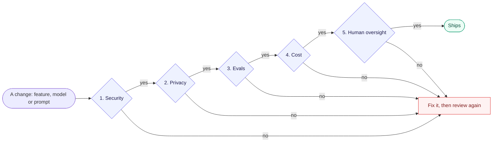
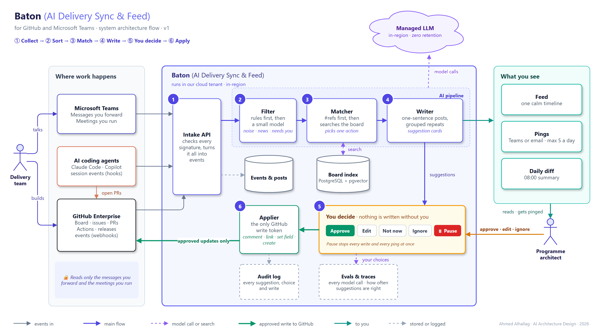

# 🏛️ Architecture Governance Pack — Baton (AI Delivery Sync & Feed for GitHub and Microsoft Teams)

* **System:** Baton (AI Delivery Sync & Feed for GitHub and Microsoft Teams)
* **AI architect:** Ahmed Alhallag
* **Governance scope:** architecture principles, architecture decision records (ADRs), ARB quality gate
* **Course context:** AI Architecture Design (MLOps MENA), Session 1 mini project
* **Status:** draft for review · 24 Oct 2026
* **Scenario:** Bunyan Digital and its Atlas programme are fictional, modelled on a real programme of a similar size

---

## 1. Executive summary and business context

At Bunyan Digital, delivery work lives in three places:

* **Talk:** it's discussed in Microsoft Teams: chats, threads and about 12 meetings a week.
* **Track:** it's tracked on one GitHub Projects board: about 650 items across 15 workstreams and 5 products.
* **Do:** it's done by 9 people and a growing number of AI teammates (Claude Code, GitHub Copilot coding agent and CLI).

The three drift apart, and the programme architect is the human glue. Actions agreed in meetings never reach the board. An agent's pull request waits two days for a reviewer. A release sits in pre-prod because nobody noticed it was ready. **Work isn't lost while people or agents do it. It's lost at the handoffs.**

**Baton (AI Delivery Sync & Feed)** watches those handoffs. It reads GitHub events, agent sessions, and the Teams messages and meetings the architect shares with it. Then it:

1. writes one calm **feed** in plain sentences,
2. **pings** only when something is waiting on a human, and
3. **suggests** board updates (link, update, sub-issue, merge, create) from what was said in Teams.

The AI suggests, the architect approves, and plain code applies the change. v1 serves the programme lead; v2 gives every teammate a personalized feed.

### Business goals and KPIs

Baselines are estimates for the scenario. Each one is measured for two weeks before launch.

| # | Goal | Today | Target | Within | How we measure |
| :- | :--- | :--- | :--- | :--- | :--- |
| **G1** | Less manual syncing between Teams and the board | ~6 h a week | ≤ 1 h a week | 3 months | Weekly time log |
| **G2** | Nothing lost after meetings | ~65% of meeting actions on the board within 24 h | 95% | 2 months | Sample 10 meetings a month |
| **G3** | Faster handoffs from agents to humans | ~60% of agent PRs reviewed within 24 h | 90% | 3 months | PR timestamps in GitHub |
| **G4** | Calm, not noisy | ~150 notifications a day | ≤ 5 pings a day, 0 missed prod approvals or P0s | 1 month | Ping log |
| **G5** | A cleaner board | ~10 duplicate items per sprint | ≤ 2 | 3 months | Items closed as duplicates |

**Non-goals:** replacing GitHub Projects or Teams; running or controlling AI agents (GitHub's Agent HQ does that); measuring individual people's productivity.

---

## 2. Architecture principles

Six principles govern the system. Each one is tied to a goal above.

| # | Principle | In one line | Goal |
| :- | :--- | :--- | :--- |
| **[P1](architecture-principles.md#p1-ai-suggests-you-approve-code-applies)** | **AI suggests, you approve, code applies** | The model never holds a write token. Only approved, structured suggestions reach GitHub. | G1, G2, G5 |
| **[P2](architecture-principles.md#p2-facts-come-from-the-source)** | **Facts come from the source** | Status, owner, health and dates are read from GitHub, never generated. Every post links back. | G3, G4 |
| **[P3](architecture-principles.md#p3-quiet-by-default)** | **Quiet by default** | Ping only for a short list of "needs you" events, at most 5 a day. Everything else waits in the feed. | G4 |
| **[P4](architecture-principles.md#p4-messages-are-data-not-instructions)** | **Messages are data, not instructions** | Text from Teams, transcripts, issues or PRs can never trigger an action by itself. | G2, G5 |
| **[P5](architecture-principles.md#p5-private-stays-private)** | **Private stays private** | It reads only what you share. Private chat text never lands in an issue the whole org can read. | Client and team trust |
| **[P6](architecture-principles.md#p6-work-not-people-scores)** | **Work, not people scores** | The feed shows work moving, never per-person speed or rankings. | Team trust |

*Full detail: [Architecture principles](architecture-principles.md)*

---

## 3. Architecture decision records

| ADR | Decision | Options considered | Chosen | Trade-off and mitigation |
| :--- | :--- | :--- | :--- | :--- |
| **[ADR-0001](../adr/0001-teams-intake-forward-first.md)** | How it reads Teams | 1. You forward 2. Listen to all chats 3. Selected channels | **You forward**, plus transcripts of meetings you run | Misses what you don't forward → one-click "Send to Baton"; selected channels in v3 |
| **[ADR-0002](../adr/0002-llm-hosting-managed-in-region.md)** | Where the AI models run | 1. Public vendor API 2. Managed models in our cloud tenant 3. Self-hosted | **Managed, in-region, zero retention**: a small model to sort, a stronger one to match and write | Fewer model choices per region → a thin model gateway and evals before any switch |
| **[ADR-0003](../adr/0003-real-time-vs-batch.md)** | Real time or batch | 1. All real time 2. All batch 3. By kind | **By kind**: pings under 1 min, meeting suggestions within 15 min, daily diff at 08:00 | Two lanes to run → one queue, two consumers |
| **[ADR-0004](../adr/0004-matching-refs-first-hybrid-search.md)** | How a message finds its board item | 1. The model reads the whole board 2. Vector search only 3. References first, then hybrid search | **References first, then keyword + vector search in PostgreSQL (pgvector)**; the model picks from the top 10 | Needs tuning → a labelled eval set and confidence bands |

*Planned:* ADR-0005 build vs buy (GitHub Agent HQ, the GitHub app for Teams) and ADR-0006 the ping channel (Teams or email).

---

## 4. Architecture Review Board (ARB) quality gate

Every change (a new feature, model or prompt) passes five gates before release. Any "no" means it doesn't ship until it's fixed.

1. **Security:** only the Applier holds a GitHub write token, and it can't delete, merge or deploy. Every webhook signature is checked. Text from messages is treated as data.
2. **Privacy:** it reads only what's shared (ADR-0001). Private chat text never reaches org-visible issues. Data and model calls stay in-region with zero retention (ADR-0002).
3. **Evals:** the right item is the top suggestion ≥ 85% of the time on a labelled set, and 0 of 20 prompt-injection tests trigger an action.
4. **Cost:** a monthly model budget with an alert at 80%; the small model filters chatter before the stronger one is called.
5. **Human oversight:** nothing is written without approval; one Pause switch stops every write and ping; everything goes into an append-only audit log.

*Full checklist: [ARB checklist](arb-checklist.md)*

---

## 5. System architecture flow

The diagram is modelled in draw.io. It shows the sources, the AI pipeline, the human approval gate, the single write path back to GitHub, and the trust plane (audit log, evals and traces).

> 📥 **Draw.io source:** [`diagrams/src/baton-architecture-flow.drawio`](../diagrams/src/baton-architecture-flow.drawio) · C4 views: [context](../diagrams/c4-l1-context.png), [containers](../diagrams/c4-l2-containers.png)

| Step | What happens | Guardrail |
| :- | :--- | :--- |
| **① Collect** | GitHub webhooks, agent hooks, forwarded Teams messages and meeting transcripts arrive at the Intake API. | Signatures checked; only shared content (ADR-0001) |
| **② Sort** | Rules first, then a small model: noise, news, needs you, or "maybe board work". | The cheap model goes first |
| **③ Match** | Explicit references (#412, a PR link) win. Otherwise it searches the board index, and the model picks one action from a fixed menu. | Confidence bands; every card shows why (ADR-0004) |
| **④ Write** | One-sentence posts, grouped repeats, suggestion cards. | Facts copied from GitHub fields (P2) |
| **⑤ You decide** | Approve, Edit, Not now or Ignore. Pause stops everything. | Nothing is written without you (P1) |
| **⑥ Apply** | The Applier, the only holder of a GitHub write token, makes the change and logs it. | It can't delete, merge or deploy |

### Follow one message

> Lina writes in the *Release sync* chat: **"export still times out on big files."** The architect clicks **Send to Baton**.
>
> ① The message arrives. ② The filter marks it as possible board work. ③ No explicit reference, so the matcher searches the board: **#412 Export times out on large files** (closed 3 days ago) is a strong match on product, words and timing. The chosen action is *Reopen*. ④ A card says: *"Lina's message looks like #412, closed 3 days ago. The fix may have broken again."* ⑤ The architect taps **Reopen**. ⑥ The Applier reopens #412 and adds a comment with a short summary and a link to the message, never the private text (P5). The feed shows: *"You reopened #412 from Lina's message."*

---

## 6. Top risks

| Risk | Why it matters | Mitigation |
| :--- | :--- | :--- |
| A wrong suggestion gets approved | The board stops being trusted | A fixed action menu; every card shows why; one-click undo from the audit log |
| Prompt injection through a message or transcript | "Close all P0s" hidden in a message | Messages are data (P4); the model has no write tools; injection tests in evals |
| Private chat leaks into a public issue | Client and team trust | Summary and link only (P5); private sources are labelled on the card |
| It becomes another noisy channel | People stop reading it | A daily ping cap; ping types nobody acts on get demoted (P3) |
| GitHub or Microsoft ship something similar | Build effort wasted | Build on their primitives, keep the layer thin, review build vs buy each quarter |
| The team feels watched | Adoption fails | No per-person metrics (P6); the team sees the same feed |

---

## 7. Deliverables

* 🏛️ **Architecture principles:** [`docs/architecture-principles.md`](architecture-principles.md)
* 📑 **Decision records:** [`adr/`](../adr/)
* 📋 **ARB checklist:** [`docs/arb-checklist.md`](arb-checklist.md)
* 📐 **Architecture flow (draw.io):** [`diagrams/src/baton-architecture-flow.drawio`](../diagrams/src/baton-architecture-flow.drawio)
* 🧭 **Capstone framing and C4 levels 1 and 2:** [`docs/01-framing.md`](01-framing.md)
